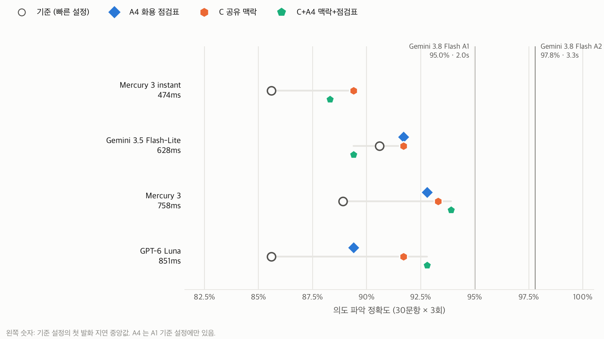
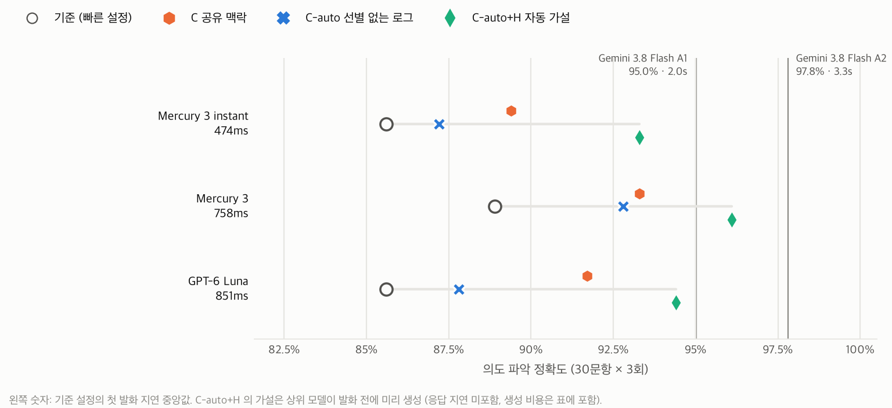
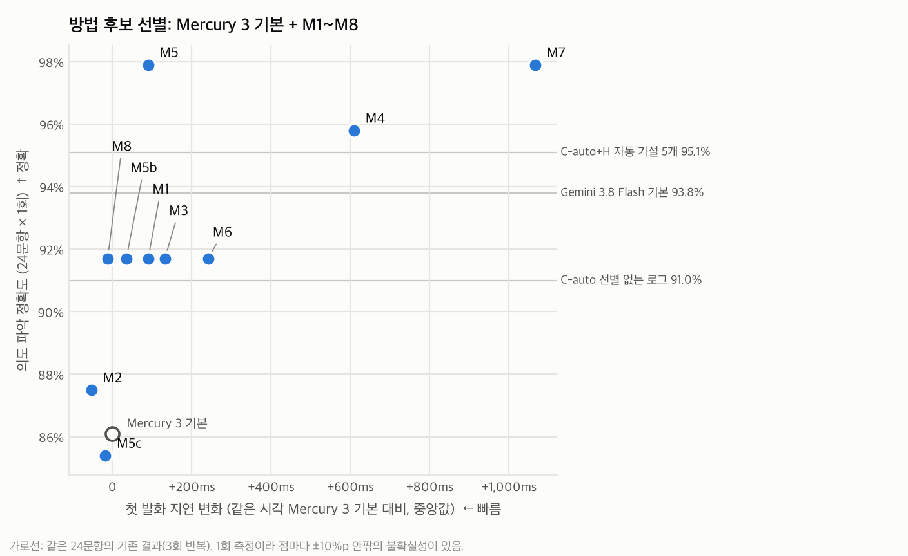
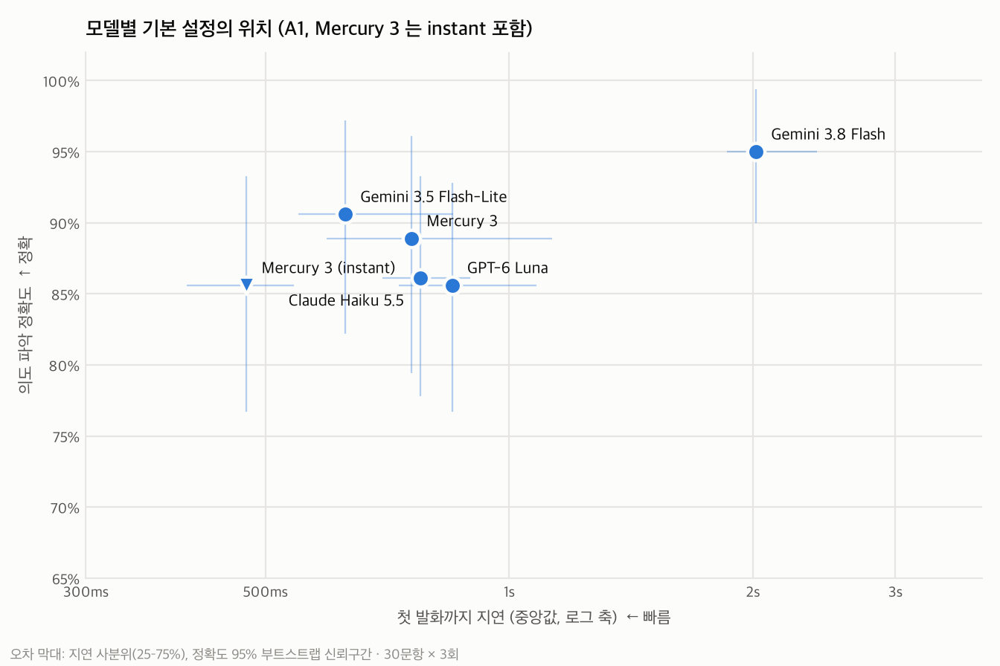
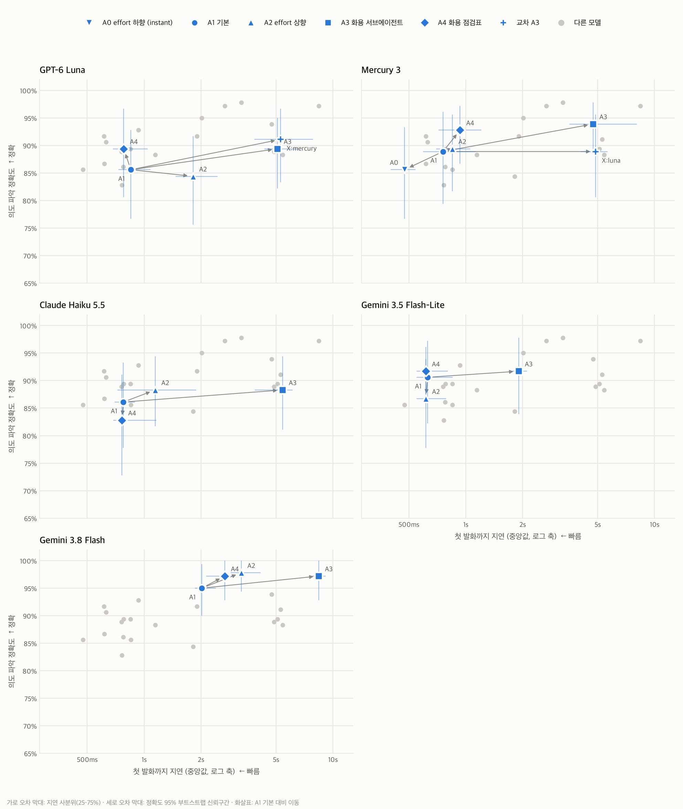
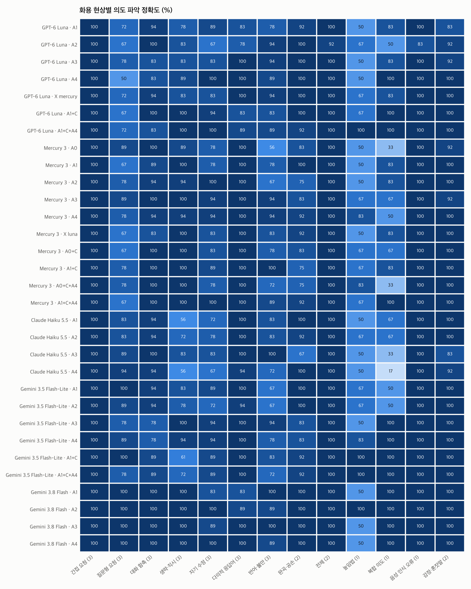

# voice-intent-pragmatics-bench

음성 대화 서비스에서 **빠르면서도 사용자의 실제 의도를 정확히 파악하는 방법**을 찾기 위한 실측 벤치마크입니다. 한국어 음성 발화 30문항을 화용론(말이 상황 속에서 하는 일을 다루는 언어학) 기준으로 만들고, 모델·설정·방법별로 **첫 발화까지 지연**과 **의도 파악 정확도**를 함께 잽니다.

<!-- RESULTS:START -->
## 결과

측정: 2026-10-26~27, 한국에서 각 사 공개 API 호출. 음성은 쓰지 않고, 음성이 인식되어 텍스트 메시지로 왔다고 가정합니다. 37개 조건 × 30문항 × 3회 = 3,330회 응답(오류 0), 별도로 지연 대조군 630회. 채점: `claude-opus-5-5` 블라인드, 응답 3,330건 + 화용 분석 630건. 4차 선별은 별도로 240회 응답 + 240건 채점, 지연 대조군 48회.

### 빠른 설정 + 화용 정보로 상위 모델에 얼마나 다가가나 (2차)

질문: 추론 강도가 낮거나 작은 모델에 화용 정보를 주면, 지연은 그대로 두고 더 강한 모델(Gemini 3.8 Flash 기본, 95.0%, 첫 발화 2.0초)의 정확도에 가까워지는가? 추가 호출이 없는 방법만 씁니다: A4 화용 점검표, C 공유 맥락(사용자 프로필 + 최근 기기·일정 기록), C+A4.



1. **공유 맥락은 지연을 거의 늘리지 않고 빠른 설정의 정확도를 올렸습니다.** 빠른 설정 4개 합산 +3.9%p (−0.3~+9.2), 부트스트랩의 96% 가 개선 쪽이고, 첫 발화 변화는 같은 실행의 대조군 대비 +11ms 입니다. 8개 조합 모두 첫 발화 변화가 −46~+29ms 였습니다.
2. **Mercury 3 기본 + 맥락+점검표: 93.9%, 첫 발화 823ms.** 상위 모델과의 정확도 격차 중 82% 를 메웠고, 남은 차이는 −1.1%p (−10.0~+5.6) 입니다. 첫 발화는 약 2.5배 빠르고, 1,000턴당 비용은 $0.15 로 상위 모델($0.28)의 약 절반입니다.
3. **GPT-6 Luna + 공유 맥락은 +6.1%p (+0.6~+12.2) 로, 2차 실험에서 신뢰구간이 0 을 벗어난 유일한 개선입니다.** 맥락+점검표는 92.8% (+7.2%p, 격차의 77%) 였습니다.
4. **효과는 모델에 따라 다릅니다.** 기준 정확도가 이미 높은 Gemini 3.5 Flash-Lite(90.6%)는 +1.1%p / −1.1%p 로 거의 변하지 않았습니다. Mercury 3 instant 는 맥락으로 +3.9%p(격차의 41%) 올랐지만 점검표를 더하면 오히려 낮아졌습니다(88.3%).
5. **맥락이 점검표보다 일관됩니다.** 맥락에 점검표를 더한 효과는 Mercury 3 +0.6%p, Luna +1.1%p, Mercury 3 instant −1.1%p, Gemini 3.5 Flash-Lite −2.3%p 로 엇갈렸습니다. 모델이 이미 하는 추론을 지시하는 것보다, 모델이 모르는 사실(관계, 일정, 기기 기록)을 주는 쪽이 효과가 컸습니다.
6. **지연은 같은 시간대끼리 비교해야 합니다.** 같은 기준 설정의 첫 발화 중앙값이 1차 실행과 2차 실행 사이에 Gemini 3.5 Flash-Lite 628 → 972ms, Luna 851 → 970ms 로 바뀌었습니다. 방법이 만든 지연 차이(±50ms)보다 시간대 차이가 훨씬 큽니다.
7. **주의.** 상위 모델과의 차이가 0 을 포함한다는 것은 "같다"는 증명이 아닙니다(30문항으로는 차이 구간이 ±8%p 안팎). 맥락 기록은 정답을 아는 작성자가 골라 효과가 낙관적일 수 있고, 상위 모델에는 같은 맥락을 주지 않았습니다. 억양 정보(한숨, 강세 등)는 실제 메시지에 없으므로 조건에서 뺐습니다.

목표선: Gemini 3.8 Flash 기본 설정 95.0% (첫 발화 2,020ms). 격차 해소율 = 정확도 변화 ÷ (목표 − 기준). 음수는 격차가 벌어졌다는 뜻, 100% 초과는 목표선을 넘었다는 뜻 (2·3차 통합 표).

| 빠른 설정 (기준 정확도 · 첫 발화) | 방법 | 정확도 | 기준 대비 변화 (95% CI) | 격차 해소율 | 목표선과의 차이 (95% CI) | 첫 발화 변화 |
|---|---|---|---|---|---|---|
| Mercury 3 instant (85.6% · 439ms) | C 공유 맥락 | 89.4% | +3.9%p (-3.9–11.7) | 41% | -5.6%p (-15.0–2.8) | +16ms |
| Mercury 3 instant (85.6% · 439ms) | C+A4 맥락+점검표 | 88.3% | +2.8%p (-1.7–7.8) | 30% | -6.7%p (-16.1–2.2) | +23ms |
| Mercury 3 instant (85.6% · 481ms) | C-auto 선별 없는 로그 | 87.2% | +1.7%p (-6.7–10.0) | 18% | -7.8%p (-20.6–2.8) | -16ms |
| Mercury 3 instant (85.6% · 481ms) | C-auto+H 자동 가설 | 93.3% | +7.8%p (1.7–14.4) | 83% | -1.7%p (-9.4–5.6) | -4ms |
| Gemini 3.5 Flash-Lite (90.6% · 628ms) | A4 화용 점검표 | 91.7% | +1.1%p (-6.1–8.9) | 25% | -3.3%p (-10.6–3.3) | -14ms |
| Gemini 3.5 Flash-Lite (90.6% · 972ms) | C 공유 맥락 | 91.7% | +1.1%p (-6.1–8.9) | 25% | -3.3%p (-13.3–5.0) | +29ms |
| Gemini 3.5 Flash-Lite (90.6% · 972ms) | C+A4 맥락+점검표 | 89.4% | -1.1%p (-8.9–6.7) | -25% | -5.6%p (-15.6–3.3) | -3ms |
| Mercury 3 (88.9% · 758ms) | A4 화용 점검표 | 92.8% | +3.9%p (-2.8–11.1) | 64% | -2.2%p (-9.4–4.4) | +175ms |
| Mercury 3 (88.9% · 824ms) | C 공유 맥락 | 93.3% | +4.4%p (-1.1–11.1) | 73% | -1.7%p (-8.3–4.4) | +6ms |
| Mercury 3 (88.9% · 824ms) | C+A4 맥락+점검표 | 93.9% | +5.0%p (0.0–11.1) | 82% | -1.1%p (-10.0–5.6) | -1ms |
| Mercury 3 (88.9% · 831ms) | C-auto 선별 없는 로그 | 92.8% | +3.9%p (-1.1–8.9) | 64% | -2.2%p (-9.4–3.9) | -31ms |
| Mercury 3 (88.9% · 831ms) | C-auto+H 자동 가설 | 96.1% | +7.2%p (2.2–13.3) | 118% | +1.1%p (-5.0–6.7) | +13ms |
| GPT-6 Luna (85.6% · 851ms) | A4 화용 점검표 | 89.4% | +3.9%p (-3.9–11.1) | 41% | -5.6%p (-15.6–2.2) | -71ms |
| GPT-6 Luna (85.6% · 970ms) | C 공유 맥락 | 91.7% | +6.1%p (0.6–12.2) | 65% | -3.3%p (-10.0–2.2) | -10ms |
| GPT-6 Luna (85.6% · 970ms) | C+A4 맥락+점검표 | 92.8% | +7.2%p (-0.0–15.0) | 77% | -2.2%p (-10.0–5.0) | -46ms |
| GPT-6 Luna (85.6% · 772ms) | C-auto 선별 없는 로그 | 87.8% | +2.2%p (-4.4–8.3) | 24% | -7.2%p (-16.7–0.6) | -11ms |
| GPT-6 Luna (85.6% · 772ms) | C-auto+H 자동 가설 | 94.4% | +8.9%p (2.8–15.6) | 95% | -0.6%p (-10.0–6.7) | -4ms |

### 맥락을 사람이 고르지 않으면 (3차)

2차의 공유 맥락(C)은 정답을 아는 작성자가 관련 사실 1~2줄을 골라 넣은 것입니다. 3차는 사람의 선별을 뺍니다. **C-auto** 는 관련 사실을 관련 없는 기록 10개 사이에 섞은 로그를 그대로 주고, **C-auto+H** 는 여기에 상위 모델(Gemini 3.8 Flash)이 사용자가 말하기 전에 로그·기기 상태·직전 대화만 보고 미리 만든 추정 최대 5개(확신도 포함, "사실이 아님" 표시)를 더합니다. 추정 생성기는 사용자 발화와 정답을 보지 않습니다.



1. **사람이 고르지 않은 로그만 주면 효과가 줄었습니다.** 같은 3개 설정에서 손으로 고른 맥락은 평균 +4.8%p, 선별 없는 로그는 합산 +2.6%p (−1.3~+6.7) 였습니다. 반어는 기준보다 낮아졌습니다(70.4 → 64.8%). 반어의 근거인 "수면 음악을 요청했는데 헤비메탈 168 BPM 재생 중" 같은 사실이 잡음 속에 묻히면, 기대와 상황의 어긋남을 놓칩니다.
2. **발화 전에 미리 만든 추정을 더하면 이 리포에서 가장 큰 개선이 나왔습니다.** 3개 설정 합산 +8.0%p (+3.9~+12.6), 부트스트랩의 100% 가 개선 쪽이고 첫 발화 변화는 −4ms 입니다. 세 설정 모두 개별 신뢰구간이 0 을 벗어났습니다: Mercury 3 instant +7.8%p, Mercury 3 +7.2%p, GPT-6 Luna +8.9%p.
3. **Mercury 3 기본 + 자동 가설: 96.1%, 첫 발화 844ms.** 상위 모델 기본 설정(95.0%, 2,020ms)과의 차이는 +1.1%p (−5.0~+6.7) 이고, 의도 이해율은 96.7% 로 같습니다.
4. **추정이 효과를 낸 현상**: 선별 없는 로그 대비 반어 64.8 → 90.7%, 자기 수정 83.3 → 96.3%, 높임법 77.8 → 83.3%. 걱정했던 과잉 행동은 없었습니다. "아 오늘 진짜 하루 길었다" 문항에는 "조명·냉난방 제어를 요청할 가능성 0.8" 같은 추정이 들어갔지만, 감정·혼잣말 정확도는 100% 였고 과잉 행동 판정은 0건이었습니다.
5. **추정이 답을 미리 알려 줘서 생긴 효과만은 아닙니다.** 추정 목록이 정답 의도를 그대로 담은 문항은 30개 중 9개였고, 부분적으로 담은 문항 11개, 전혀 담지 않은 문항 10개였습니다(분석 채점기로 대조). 효과는 세 묶음에서 비슷했습니다: 정답 명시 +9.3%p, 부분 포함 +7.1%p, 정답 없음 +7.8%p (0.0~18.3). 정답을 담지 않은 추정도 도움이 된 것은, 추정이 잡음 섞인 로그에서 관련 사실을 짚어 주는 역할을 했기 때문으로 보입니다 (가설).
6. **미리 계산할 수 있는 문항만 봐도 효과가 남습니다.** 직전 비서 발화가 있는 11개 문항은 비서가 말한 뒤에야 추정을 만들 수 있어, 아래 생성 시간으로는 대개 늦습니다. 상태만으로 미리 만들 수 있는 19개 문항의 효과는 +7.3%p (+2.6~+13.2) 였습니다.

C-auto+H 의 기준 대비 효과를 문항 묶음별로 나눈 값 (빠른 설정 3개 평균, 문항 단위 부트스트랩).

| 문항 묶음 | 문항 수 | C-auto+H 효과 (95% CI) |
|---|---|---|
| 추정이 정답 의도를 명시 (2점) | 9 | +9.3%p (1.9–17.9) |
| 추정이 정답 의도를 부분 포함 (1점) | 11 | +7.1%p (1.5–13.1) |
| 추정에 정답 의도 없음 (0점) | 10 | +7.8%p (0.0–18.3) |
| 직전 비서 발화 있음 (발화 뒤에야 추정 가능) | 11 | +9.1%p (2.0–17.2) |
| 직전 비서 발화 없음 (상태만으로 미리 추정 가능) | 19 | +7.3%p (2.6–13.2) |

7. **대가는 비용과 생성 시간입니다.** 상위 모델이 매 턴 추정을 만들면 1,000턴당 $3.32 가 더 들어, 응답 모델을 합쳐 $3.41~$3.49 입니다. 상위 모델에 바로 답하게 하는 것($0.28)의 약 12배입니다. 생성 시간은 중앙값 7.6초, 상위 10% 9.6초라, 사용자가 비서의 말이 끝나고 몇 초 안에 다시 말하면 추정이 준비되지 않습니다. 실제로는 상태가 바뀔 때만 비동기로 생성하거나, 더 싼 생성 모델을 쓰거나, 출력을 줄여야 합니다 (가설, 미검증).
8. **해석.** 효과의 출처는 상위 모델이 미리 해 둔 상황 해석입니다. 단, 추정이 사용자가 말하기 전에 준비되어 있을 때의 이야기입니다. 빠른 모델이 스스로 화용 추론을 더 하게 한 방법(점검표, effort 상향)은 효과가 작았지만, 강한 모델이 발화 전에 상황을 해석해 둔 결과를 빠른 모델에 주자 상위 모델 수준에 도달했습니다. 정확도와 응답 속도는 분리할 수 있었지만, 비용은 분리되지 않았습니다.
9. **주의.** 문항의 상태와 로그는 시나리오에 맞춰 쓴 것이라 실제 로그보다 "다음에 일어날 일"을 추정하기 쉽습니다. 추정 생성기가 목표선과 같은 Gemini 3.8 Flash 라는 점, 30문항으로는 상위 모델과 같다는 것을 증명할 수 없다는 점도 함께 봐야 합니다.

### 방법 후보 선별 (4차)

[관련 연구](docs/related-work.md)에서 뽑은 방법 후보 6개(M1~M6)를 한 번씩 시험했고, 이어서 4개를 더 시험했습니다. 답할 때 해석 10개를 숨겨 쓰게 하기(M7), 속으로만 떠올리게 하기(M8), M5 의 "후보 중 고르기" 지시에 싼 후보(M5b)와 빠른 후보(M5c)를 넣기입니다. 비용을 줄이려고 응답 모델은 Mercury 3 기본 하나, 문항은 모든 조건이 만점이던 6문항을 뺀 24개, 반복은 1회입니다. 정밀 측정이 아니라 "유망 / 보류 / 탈락"을 가르는 선별용 결과입니다.



Mercury 3 기본 응답 모델, 24문항 × 1회 (간접 요청·전제·음성 인식 오류 6문항 제외). 같은 24문항 기준값: Mercury 3 기본 86.1%, C-auto 선별 없는 로그 91.0%, C-auto+H 자동 가설 5개 95.1%, Gemini 3.8 Flash 기본 93.8%. 첫 발화 변화는 묶음마다 같은 실행에서 다시 잰 Mercury 3 기본 대비이며, 그 p50 은 M1~M6 묶음 796ms, M7·M8·M5b·M5c 묶음 828ms 입니다. 1회 측정이라 신뢰구간이 넓은 선별용 결과입니다.

| 방법 | 계산 시점 | 정확도 | 기본 대비 (95% CI) | 선별 없는 로그 대비 | 첫 발화 p50 (변화) | 생성 시간 p50 / p90 | 1,000턴당 비용 |
|---|---|---|---|---|---|---|---|
| M1 발화 전 상황 10개 (Gemini 3.8 Flash 생성) | 발화 전 | 91.7% | +5.6%p (-6.9–18.1) | +0.7%p | 887ms (+90) | 18.1s / 22.5s | $7.65 |
| M2 발화 전 상황 10개 (Mercury 3 low 생성) | 발화 전 | 87.5% | +1.4%p (-9.0–11.1) | -3.5%p | 743ms (-53) | 5.3s / 8.3s | $1.19 |
| M3 로그를 관련 사실 요약으로 다시 쓰기 (Mercury 3 low) | 발화 전 | 91.7% | +5.6%p (-8.3–19.4) | +0.7%p | 928ms (+132) | 1.9s / 3.4s | $0.51 |
| M4 발화 후 해석 3~5개 쓰고 골라 답하기 (숨김) (형식 실패 1건) | 발화 시점 | 95.8% | +9.7%p (-0.7–22.2) | +4.9%p | 1,405ms (+609) | – | $0.27 |
| M5 M1 후보 중 '이 의도면 이렇게 말했을까'로 고르기 | 발화 전 + 발화 시점 | 97.9% | +11.8%p (2.8–22.9) | +6.9%p | 886ms (+90) | 18.1s / 22.5s | $7.65 |
| M6 발화 앞 절반으로 가설 5개 (Mercury 3 instant) | 말하는 중 | 91.7% | +5.6%p (-6.2–18.1) | +0.7%p | 1,038ms (+242) | 1.2s / 1.4s | $0.36 |
| M7 발화 후 해석 10개 쓰고 골라 답하기 (숨김) (형식 실패 2건) | 발화 시점 | 97.9% | +11.8%p (0.7–24.3) | +6.9%p | 1,895ms (+1,066) | – | $0.33 |
| M8 발화 후 해석 10개를 속으로만 떠올리고 답하기 | 발화 시점 | 91.7% | +5.6%p (0.7–13.2) | +0.7%p | 816ms (-12) | – | $0.15 |
| M5b M2 후보(싼 생성기) 중 고르기 | 발화 전 + 발화 시점 | 91.7% | +5.6%p (0.7–13.2) | +0.7%p | 863ms (+35) | 5.3s / 8.3s | $1.19 |
| M5c M6 후보(말하는 중, 빠른 생성기) 중 고르기 | 말하는 중 + 발화 시점 | 85.4% | -0.7%p (-11.8–9.7) | -5.6%p | 811ms (-18) | 1.2s / 1.4s | $0.40 |

1. **유망: M5 (미리 만든 후보 중 "이 의도라면 이렇게 말했을까"로 고르기) 97.9%. 단, 후보를 강한 모델이 만들었을 때만입니다.** 같은 고르기 지시에 싼 모델(Mercury 3 low)이 만든 후보를 넣은 M5b 는 91.7%, 사용자가 말하는 중 빠른 모델(Mercury 3 instant)이 만든 후보를 넣은 M5c 는 85.4% 로 선별 없는 로그(91.0%)보다 낫지 않았습니다. 효과는 고르기 지시보다 후보의 질에서 옵니다. 강한 모델 후보는 생성에 18초, 1,000턴당 $7.65 가 듭니다. 같은 상황 10개를 "참고하라"며 준 M1 은 91.7% 였으므로 지시 방식도 영향을 줍니다. M5 와 M5b 가 갈린 2문항(QFR-02, HON-01)은 둘 다 정답 기준에 논란이 있는 문항이라 조심해서 봐야 합니다.
2. **유망: M4 (답할 때 해석 3~5개를 숨겨 쓴 뒤 골라 답하기) 95.8%.** 미리 계산할 것이 없고 1,000턴당 $0.27 입니다. 대신 해석을 쓰는 동안 첫 발화가 +609ms 늦어집니다. 해석을 닫지 않아 들리는 말에 섞인 형식 실패가 24건 중 1건 있었습니다.
3. **해석을 10개로 늘린 M7 은 97.9% 지만, M4 와 점수가 다른 문항은 HON-01 하나뿐이고 첫 발화는 +1,066ms 로 M4 의 약 두 배 늦었습니다.** 숨겨 쓰는 해석이 길어진 만큼(추론 제외 출력 p50 134 → 225토큰, 추론 토큰 329 → 454) 기다리는 시간이 늘었습니다. 해석을 쓰지 않고 바로 답한 형식 실패가 2건 있었습니다(들리는 말에 해석이 섞이지는 않음). 개수를 늘려 얻은 정확도는 측정 오차 안이고, 속도는 확실히 잃었습니다.
4. **속으로만 해석 10개를 떠올리게 한 M8 은 효과가 없었습니다 (91.7%, 첫 발화 -12ms).** 추론 토큰이 같은 시각 대조군과 같아(p50 168 대 182), 지시를 받고도 실제로 더 생각하지 않은 것으로 보입니다. 이번 결과에서는 해석을 글로 쓰게 해야 계산이 늘었고, 그 시간만큼 첫 발화가 늦어졌습니다.
5. **보류: M3 (로그를 관련 사실 요약으로 다시 쓰기), M6 (발화 앞 절반으로 가설).** 둘 다 91.7% 로 선별 없는 로그(91.0%)와 거의 같았습니다. 생성이 빠르고(1.9초, 1.2초) 싸지만($0.51, $0.36) 이번 선별에서는 이득이 보이지 않았습니다. M6 생성이 빠른 이유는 Mercury 3 instant 가 생각 토큰 없이 출력 약 320토큰만 쓰기 때문입니다(M1 은 생각 약 1,200 + 출력 약 700토큰을 초당 약 100토큰으로 생성). 다만 1.2초라도 사용자가 말을 마치기 전에 끝난다는 보장은 없습니다. 발화 뒤 절반은 0~14음절이라, 초당 5~7음절로 말한다고 가정하면 말이 끝나기 전에 생성이 끝나는 문항은 24개 중 7~11개입니다. 말이 끝난 뒤 끝을 감지하는 대기 500ms 를 더해야 15~18개가 됩니다(발화 속도와 대기 시간은 가정값이며 측정하지 않았습니다).
6. **탈락: M1·M2 (발화 전 상황 10개).** 강한 모델이 만든 10개(91.7%)는 3차의 5개(95.1%)보다 낮았고, 싼 모델이 만든 10개(87.5%)는 로그만 줬을 때(91.0%)보다도 낮았습니다. 상황을 많이 유추시키면 겹치거나 빗나간 추정이 늘어 오히려 방해가 됩니다. 해석을 여러 개 만들면 서로 비슷해진다는 선행 연구([2505.11679](https://arxiv.org/abs/2505.11679))의 경고와 같은 방향입니다.
7. **주의.** 1회 측정·24문항이라 점마다 ±10%p 안팎의 불확실성이 있어, 5%p 안쪽의 차이로는 순위를 정할 수 없습니다. 첫 발화 변화도 24회의 중앙값이라 ±100ms 정도는 흔들립니다. M5·M4·M7 은 3회 반복으로 확인해야 합니다.

### 모델별 기본 설정의 위치 (1차)



### 1차 실험 핵심 발견

1. **기본 설정끼리의 정확도 차이는 30문항으로 가를 수 없었습니다.** 85.6~95.0% 범위에서 신뢰구간이 겹치고, Mercury 3 A1 대비 모든 모델의 차이가 0을 포함합니다. 지연은 분명히 다릅니다: Mercury 3 instant 474ms, Gemini 3.5 Flash-Lite 628ms, Mercury 3 758ms, Claude Haiku 5.5 777ms, GPT-6 Luna 851ms, Gemini 3.8 Flash 2,020ms (중앙값).
2. **effort 상향(A2)은 정확도를 거의 올리지 못했습니다.** 실제로 추론이 늘어난 4개 모델 합산 +1.1%p (−1.2~+3.6), 첫 발화는 모델별 중앙값 +666ms, Luna 는 +964ms 입니다. Gemini 3.5 Flash-Lite 는 LOW 에서도 추론 토큰이 0 이라 effort 가 오르지 않았으므로 합산에서 뺐습니다.
3. **화용 서브에이전트(A3)는 개선 경향이 가장 크지만 지연 비용이 큽니다.** 합산 +2.9%p (−1.0~+7.7), 첫 발화 +4.2초. 분석이 끝나야 응답을 시작하는 구조로는 음성 턴에 쓰기 어렵습니다. 분석 자체의 정확도는 87~96% 였습니다. 7개 분석 조건 중 4개는 분석이 응답보다 정확해 응답 모델이 분석을 다 따르지 못한 경우가 있었고, 1개는 같았고, 2개(Luna, Gemini 3.8 Flash)는 응답이 분석보다 정확했습니다.
4. **화용 점검표(A4)는 추가 지연이 거의 없이 합산 +1.6%p (−1.1~+4.3).** 첫 발화 변화는 모델별 중앙값 −13ms 이고, 예외로 Gemini 3.8 Flash 는 점검표 때문에 생각을 더 해서 +654ms 였습니다. 효과는 모델에 따라 다릅니다: Luna·Mercury +3.9%p, Gemini 3.8 Flash +2.2%p, Gemini 3.5 Flash-Lite +1.1%p, Haiku −3.3%p. 프롬프트 한 단락이므로 모델별로 켜고 끄며 검증하기 쉽습니다.
5. **1차 실험에서는 95% 신뢰구간이 0을 완전히 벗어난 비교가 없었습니다.** (2·3차 실험에서 예외가 나왔습니다.) 0에 걸친 비교는 3개(교차 A3 mercury→luna +5.6%p, Gemini 3.8 Flash A3 +2.2%p, Gemini 3.5 Flash-Lite A2 −3.9%p)인데, 마지막은 추론 토큰이 0으로 A1 과 사실상 같은 설정입니다. 같은 설정을 반복해도 4%p 안팎은 움직인다는 뜻이고, 이보다 작은 차이는 잡음으로 봐야 합니다.
6. **의도는 대부분 맞혔고, 감점의 상당수는 '실행 전 확인'이었습니다.** 의도를 맞히고 확인만 한 응답을 정답으로 치는 의도 이해율은 82~100%입니다. 0점 중 문자적 의미로만 답한 경우는 두 문항에 몰렸습니다. "하 이거 들으면 잠 참 잘 오겠다"의 반어를 칭찬으로 받은 경우(SAR-02, 12건)는 분명한 오해입니다. "지금 출발하면 강남역에 여섯 시 반까지 갈 수 있나"(QFR-02, 22건)는 도착 가능 여부에 답했지만 길안내 제안이 없어 0점이 된 경우로, 정답 기준이 논쟁적입니다 (아래 채점 검수 참고).
7. **기본 설정 중 가장 정확한 모델은 가장 느리고 비쌉니다.** Gemini 3.8 Flash A1 은 기본 설정 중 95.0% 로 가장 높지만 (전체 최고는 같은 모델 A2 의 97.8%, 첫 발화 3.3초) 첫 발화 2.0초, 1,000턴당 $0.28 로 Mercury 3 A1($0.11), Luna A1($0.04)보다 비쌉니다.

### 이 결과로 본 방법론

- 응답 경로에는 **빠른 설정 + 공유 맥락**을 둡니다. 지연은 거의 그대로이고(±50ms), 4개 빠른 설정 합산 +3.9%p 였습니다. 화용 점검표는 모델별로 효과를 확인한 뒤 더합니다.
- **상황 해석은 발화 경로 밖에서 미리 합니다.** 강한 모델이 상태가 바뀔 때 추정을 만들어 두고, 빠른 모델은 그것을 참고해 바로 답합니다. 3차에서 정확도는 상위 모델 수준, 응답 지연은 빠른 모델 수준이었습니다. 다만 매 턴 생성하면 비용이 상위 모델 직접 응답의 약 12배라, 생성 주기와 생성 모델 선택이 다음 과제입니다.
- **effort 를 올려 의도 파악을 보완하지 않습니다.** 이 질의셋에서는 지연만 늘었습니다.
- 화용 분석 서브에이전트는 **응답을 기다리게 하는 위치에 두지 않습니다.** 맞장구를 먼저 말하는 동안 분석하거나, 확신도가 낮을 때만 호출하거나, 분석 결과를 다음 턴 맥락으로 넘기는 구조가 다음 실험 후보입니다 (가설, 미검증).
- 화용론을 쓰는 방법은 **추론 규칙을 지시하는 것보다 공유 맥락을 공급하는 것**입니다. 화용 해석은 화자와 청자가 공유하는 맥락에 기대고, 모델은 관습적인 화용 추론을 이미 하고 있습니다.
- **확인 질문 정책을 따로 설계합니다.** 문자 발송·예약처럼 되돌리기 어려운 행동은 확인이 맞고, 조명·볼륨 같은 조작은 바로 실행하는 편이 맞습니다. 이 리포의 정답 기준은 이 구분을 충분히 반영하지 못했습니다 (아래 채점 검수 참고).
- 방법 간 차이를 가르려면 **더 어려운 문항과 더 많은 문항**이 필요합니다. 간접 요청, 전제, 음성 인식 오류는 거의 모든 조건이 100% 였습니다.

### 전체 결과

의도 정확도 = 채점 점수(0/1/2) 평균. 의도 이해율 = 의도를 맞히고 확인만 한 1점도 정답으로 본 비율. 엄격 정확도 = 2점 비율. 첫 발화 = 첫 보이는 텍스트까지 (A3·교차는 분석 시간 포함). 1,000턴당 비용 = 실측 토큰 × 공식 가격 (분석 호출 포함). C·C+A4 의 첫 발화는 2차 실행 시각의 값이라, 같은 시각의 기준 설정과 비교한 변화는 위 2차 표를 봐야 합니다.

| 모델 | 조건 | 의도 정확도 (95% CI) | 의도 이해율 | 엄격 정확도 | 첫 발화 p50 | 첫 발화 p90 | 분석 시간 p50 | 1,000턴당 비용 | 오류 |
|---|---|---|---|---|---|---|---|---|---|
| GPT-6 Luna | A1 기본 | 85.6% (76.7–92.8) | 88.9% | 74.4% | 851ms | 1,773ms | – | $0.04 | 0 |
| GPT-6 Luna | A2 effort 상향 | 84.4% (75.6–91.7) | 84.4% | 73.3% | 1,815ms | 4,210ms | – | $0.08 | 0 |
| GPT-6 Luna | A3 화용 서브에이전트 | 89.4% (82.2–95.0) | 92.2% | 80.0% | 5,092ms | 10,393ms | 4,172ms | $0.24 | 0 |
| GPT-6 Luna | A4 화용 점검표 | 89.4% (80.6–96.7) | 90.0% | 82.2% | 780ms | 1,825ms | – | $0.06 | 0 |
| GPT-6 Luna | 교차 A3 (mercury→luna) | 91.1% (83.3–96.7) | 93.3% | 85.6% | 5,273ms | 12,187ms | 4,252ms | $0.90 | 0 |
| GPT-6 Luna | C 공유 맥락 (A1 기준) | 91.7% (84.4–97.2) | 92.2% | 85.6% | 960ms | 2,152ms | – | $0.05 | 0 |
| GPT-6 Luna | C+A4 맥락+점검표 (A1 기준) | 92.8% (86.1–97.8) | 90.0% | 87.8% | 924ms | 1,698ms | – | $0.07 | 0 |
| GPT-6 Luna | C-auto 선별 없는 로그 (A1 기준) | 87.8% (79.4–94.4) | 91.1% | 80.0% | 761ms | 951ms | – | $0.07 | 0 |
| GPT-6 Luna | C-auto+H 자동 가설 (A1 기준) | 94.4% (86.7–98.9) | 96.7% | 92.2% | 768ms | 1,113ms | – | $3.41 | 0 |
| Mercury 3 | A0 effort 하향 (instant) | 85.6% (76.7–93.3) | 82.2% | 81.1% | 474ms | 641ms | – | $0.03 | 0 |
| Mercury 3 | A1 기본 | 88.9% (79.4–96.1) | 93.3% | 82.2% | 758ms | 1,446ms | – | $0.11 | 0 |
| Mercury 3 | A2 effort 상향 | 89.4% (81.7–95.6) | 91.1% | 85.6% | 848ms | 1,517ms | – | $0.12 | 0 |
| Mercury 3 | A3 화용 서브에이전트 | 93.9% (89.4–97.8) | 93.3% | 90.0% | 4,735ms | 12,610ms | 3,799ms | $0.98 | 0 |
| Mercury 3 | A4 화용 점검표 | 92.8% (86.7–97.2) | 92.2% | 88.9% | 933ms | 1,541ms | – | $0.15 | 0 |
| Mercury 3 | 교차 A3 (luna→mercury) | 88.9% (80.6–95.6) | 91.1% | 82.2% | 4,877ms | 7,628ms | 4,138ms | $0.32 | 0 |
| Mercury 3 | C 공유 맥락 (A0 기준) | 89.4% (80.6–96.1) | 84.4% | 82.2% | 455ms | 692ms | – | $0.05 | 0 |
| Mercury 3 | C 공유 맥락 (A1 기준) | 93.3% (87.2–97.8) | 93.3% | 90.0% | 830ms | 1,483ms | – | $0.13 | 0 |
| Mercury 3 | C+A4 맥락+점검표 (A0 기준) | 88.3% (79.4–95.6) | 88.9% | 83.3% | 462ms | 656ms | – | $0.07 | 0 |
| Mercury 3 | C+A4 맥락+점검표 (A1 기준) | 93.9% (86.1–98.9) | 93.3% | 91.1% | 823ms | 1,444ms | – | $0.15 | 0 |
| Mercury 3 | C-auto 선별 없는 로그 (A0 기준) | 87.2% (76.1–96.7) | 84.4% | 83.3% | 465ms | 627ms | – | $0.07 | 0 |
| Mercury 3 | C-auto 선별 없는 로그 (A1 기준) | 92.8% (86.7–97.8) | 94.4% | 90.0% | 800ms | 1,379ms | – | $0.14 | 0 |
| Mercury 3 | C-auto+H 자동 가설 (A0 기준) | 93.3% (86.7–98.3) | 91.1% | 90.0% | 477ms | 697ms | – | $3.41 | 0 |
| Mercury 3 | C-auto+H 자동 가설 (A1 기준) | 96.1% (90.6–100.0) | 96.7% | 94.4% | 844ms | 1,457ms | – | $3.49 | 0 |
| Claude Haiku 5.5 | A1 기본 | 86.1% (77.8–93.3) | 93.3% | 75.6% | 777ms | 1,324ms | – | $0.06 | 0 |
| Claude Haiku 5.5 | A2 effort 상향 | 88.3% (81.7–94.4) | 97.8% | 78.9% | 1,145ms | 2,412ms | – | $0.12 | 0 |
| Claude Haiku 5.5 | A3 화용 서브에이전트 | 88.3% (81.1–94.4) | 88.9% | 81.1% | 5,417ms | 7,326ms | 4,331ms | $0.49 | 0 |
| Claude Haiku 5.5 | A4 화용 점검표 | 82.8% (72.8–91.1) | 92.2% | 72.2% | 764ms | 1,758ms | – | $0.09 | 0 |
| Gemini 3.5 Flash-Lite | A1 기본 | 90.6% (82.2–97.2) | 96.7% | 84.4% | 628ms | 983ms | – | $0.11 | 0 |
| Gemini 3.5 Flash-Lite | A2 effort 상향 | 86.7% (77.8–93.9) | 92.2% | 77.8% | 615ms | 911ms | – | $0.11 | 0 |
| Gemini 3.5 Flash-Lite | A3 화용 서브에이전트 | 91.7% (83.9–97.8) | 94.4% | 86.7% | 1,907ms | 2,373ms | 1,230ms | $0.80 | 0 |
| Gemini 3.5 Flash-Lite | A4 화용 점검표 | 91.7% (86.7–96.1) | 96.7% | 83.3% | 614ms | 921ms | – | $0.17 | 0 |
| Gemini 3.5 Flash-Lite | C 공유 맥락 (A1 기준) | 91.7% (83.9–97.8) | 94.4% | 86.7% | 1,001ms | 1,214ms | – | $0.16 | 0 |
| Gemini 3.5 Flash-Lite | C+A4 맥락+점검표 (A1 기준) | 89.4% (81.1–96.1) | 92.2% | 82.2% | 969ms | 1,150ms | – | $0.22 | 0 |
| Gemini 3.8 Flash | A1 기본 | 95.0% (90.0–99.4) | 96.7% | 90.0% | 2,020ms | 2,874ms | – | $0.28 | 0 |
| Gemini 3.8 Flash | A2 effort 상향 | 97.8% (94.4–100.0) | 97.8% | 95.6% | 3,269ms | 4,713ms | – | $0.86 | 0 |
| Gemini 3.8 Flash | A3 화용 서브에이전트 | 97.2% (92.8–100.0) | 100.0% | 94.4% | 8,415ms | 10,201ms | 5,950ms | $2.65 | 0 |
| Gemini 3.8 Flash | A4 화용 점검표 | 97.2% (92.8–100.0) | 100.0% | 94.4% | 2,674ms | 3,570ms | – | $0.65 | 0 |

### 기준 대비 변화 (같은 문항끼리 짝지은 비교)

Gemini 3.5 Flash-Lite A2 는 추론 토큰 0 으로 effort 가 오르지 않아 모델 합산에서 뺐습니다 (모델별 행에는 남김). C·C+A4 는 자기 기준 설정과 비교하고, 첫 발화 변화는 같은 실행의 지연 대조군 기준입니다.

| 비교 대상 | 조건 | 기준 대비 정확도 변화 (95% CI) | 부트스트랩에서 Δ>0 비율 | 기준 대비 첫 발화 p50 변화 |
|---|---|---|---|---|
| GPT-6 Luna | A2 effort 상향 | -1.1%p (-7.8–6.1) | 36% | +964ms |
| GPT-6 Luna | A3 화용 서브에이전트 | +3.9%p (-1.1–9.4) | 94% | +4,241ms |
| GPT-6 Luna | A4 화용 점검표 | +3.9%p (-3.9–11.1) | 83% | -71ms |
| GPT-6 Luna | 교차 A3 (mercury→luna) | +5.6%p (0.0–11.1) | 98% | +4,422ms |
| GPT-6 Luna | C 공유 맥락 (A1 기준) | +6.1%p (0.6–12.2) | 98% | -10ms |
| GPT-6 Luna | C+A4 맥락+점검표 (A1 기준) | +7.2%p (-0.0–15.0) | 97% | -46ms |
| GPT-6 Luna | C-auto 선별 없는 로그 (A1 기준) | +2.2%p (-4.4–8.3) | 74% | -11ms |
| GPT-6 Luna | C-auto+H 자동 가설 (A1 기준) | +8.9%p (2.8–15.6) | 100% | -4ms |
| Mercury 3 | A0 effort 하향 (instant) | -3.3%p (-11.1–5.0) | 18% | -284ms |
| Mercury 3 | A2 effort 상향 | +0.6%p (-5.0–6.7) | 54% | +90ms |
| Mercury 3 | A3 화용 서브에이전트 | +5.0%p (-2.2–13.3) | 90% | +3,977ms |
| Mercury 3 | A4 화용 점검표 | +3.9%p (-2.8–11.1) | 89% | +175ms |
| Mercury 3 | 교차 A3 (luna→mercury) | 0.0%p (-5.6–6.1) | 48% | +4,119ms |
| Mercury 3 | C 공유 맥락 (A0 기준) | +3.9%p (-3.9–11.7) | 88% | +16ms |
| Mercury 3 | C 공유 맥락 (A1 기준) | +4.4%p (-1.1–11.1) | 92% | +6ms |
| Mercury 3 | C+A4 맥락+점검표 (A0 기준) | +2.8%p (-1.7–7.8) | 90% | +23ms |
| Mercury 3 | C+A4 맥락+점검표 (A1 기준) | +5.0%p (0.0–11.1) | 97% | -1ms |
| Mercury 3 | C-auto 선별 없는 로그 (A0 기준) | +1.7%p (-6.7–10.0) | 68% | -16ms |
| Mercury 3 | C-auto 선별 없는 로그 (A1 기준) | +3.9%p (-1.1–8.9) | 96% | -31ms |
| Mercury 3 | C-auto+H 자동 가설 (A0 기준) | +7.8%p (1.7–14.4) | 100% | -4ms |
| Mercury 3 | C-auto+H 자동 가설 (A1 기준) | +7.2%p (2.2–13.3) | 100% | +13ms |
| Claude Haiku 5.5 | A2 effort 상향 | +2.2%p (-2.8–7.8) | 79% | +368ms |
| Claude Haiku 5.5 | A3 화용 서브에이전트 | +2.2%p (-6.7–12.2) | 68% | +4,640ms |
| Claude Haiku 5.5 | A4 화용 점검표 | -3.3%p (-8.9–1.7) | 10% | -13ms |
| Gemini 3.5 Flash-Lite | A2 effort 상향 | -3.9%p (-8.3–0.0) | 2% | -13ms |
| Gemini 3.5 Flash-Lite | A3 화용 서브에이전트 | +1.1%p (-8.3–11.1) | 58% | +1,279ms |
| Gemini 3.5 Flash-Lite | A4 화용 점검표 | +1.1%p (-6.1–8.9) | 62% | -14ms |
| Gemini 3.5 Flash-Lite | C 공유 맥락 (A1 기준) | +1.1%p (-6.1–8.9) | 60% | +29ms |
| Gemini 3.5 Flash-Lite | C+A4 맥락+점검표 (A1 기준) | -1.1%p (-8.9–6.7) | 36% | -3ms |
| Gemini 3.8 Flash | A2 effort 상향 | +2.8%p (-1.7–7.8) | 86% | +1,249ms |
| Gemini 3.8 Flash | A3 화용 서브에이전트 | +2.2%p (0.0–5.6) | 86% | +6,395ms |
| Gemini 3.8 Flash | A4 화용 점검표 | +2.2%p (-2.2–6.7) | 79% | +654ms |
| 모델 합산 (Gemini 3.8 Flash, Claude Haiku 5.5, GPT-6 Luna, Mercury 3) | A2 effort 상향 | +1.1%p (-1.2–3.6) | 80% | +666ms |
| 모델 합산 (Gemini 3.5 Flash-Lite, Gemini 3.8 Flash, Claude Haiku 5.5, GPT-6 Luna, Mercury 3) | A3 화용 서브에이전트 | +2.9%p (-1.0–7.7) | 92% | +4,241ms |
| 모델 합산 (Gemini 3.5 Flash-Lite, Gemini 3.8 Flash, Claude Haiku 5.5, GPT-6 Luna, Mercury 3) | A4 화용 점검표 | +1.6%p (-1.1–4.3) | 87% | -13ms |
| 모델 합산 (GPT-6 Luna, Mercury 3) | 교차 A3 | +2.8%p (-1.4–7.8) | 88% | +4,270ms |
| 빠른 설정 4개 합산 (Gemini 3.5 Flash-Lite, GPT-6 Luna, Mercury 3) | C 공유 맥락 | +3.9%p (-0.3–9.2) | 96% | +11ms |
| 빠른 설정 4개 합산 (Gemini 3.5 Flash-Lite, GPT-6 Luna, Mercury 3) | C+A4 맥락+점검표 | +3.5%p (-1.1–8.5) | 93% | -2ms |
| 빠른 설정 3개 합산 (GPT-6 Luna, Mercury 3) | C-auto 선별 없는 로그 | +2.6%p (-1.3–6.7) | 90% | -16ms |
| 빠른 설정 3개 합산 (GPT-6 Luna, Mercury 3) | C-auto+H 자동 가설 | +8.0%p (3.9–12.6) | 100% | -4ms |

### 모델 간 비교 (Mercury 3 공식 음성 설정 기준)

| 모델 · 설정 | Mercury 3 A1 대비 정확도 변화 (95% CI) | 부트스트랩에서 Δ>0 비율 | 첫 발화 p50 변화 |
|---|---|---|---|
| GPT-6 Luna · A1 기본 | -3.3%p (-10.6–2.8) | 16% | +93ms |
| Mercury 3 · A0 effort 하향 (instant) | -3.3%p (-11.1–5.0) | 18% | -284ms |
| Claude Haiku 5.5 · A1 기본 | -2.8%p (-13.3–7.8) | 27% | +19ms |
| Gemini 3.5 Flash-Lite · A1 기본 | +1.7%p (-6.1–10.6) | 60% | -130ms |
| Gemini 3.8 Flash · A1 기본 | +6.1%p (-1.7–16.1) | 92% | +1,262ms |

### 방법별 위치



### 화용 현상별 정확도



### 채점 검수

- 채점 10건을 점수대별로 뽑아 직접 확인했습니다. 8건은 판단이 같았습니다. 1건은 채점이 과했고(haiku.A2 QFR-03: 의도는 맞히고 되물었는데 0점, 루브릭상 1점), 1건은 경계 사례였습니다(gemini.A3 IMP-03 "예약은 취소할게요"를 1점).
- 정답 기준 자체가 논쟁적인 문항이 있습니다. 결과를 본 뒤 정답을 고치지 않았고, 대신 의도 이해율을 보조 지표로 함께 보고합니다.
  - REP-01: "어느 치과로 예약할까요?"는 빠진 정보를 묻는 정당한 질문이고 공식 음성 프롬프트 3번 규칙과도 맞는데, 되묻기를 허용하지 않아 1점이 됐습니다.
  - HON-01: "할머니께 문자로 보낼까요?"처럼 되돌리기 어려운 발송 전에 확인한 응답이 1점이 됐습니다 (57건 중 47건).
  - QFR-02: "갈 수 있나"에 도착 가능 여부로 답한 응답이 길안내 제안이 없다는 이유로 0점이 됐습니다 (22건). 길안내 요청을 함축으로 볼지는 해석이 갈립니다.
- 채점 비용: 건당 약 $0.0066 (입력 약 1,000 토큰, 출력 약 130 토큰).

결과는 모두 `results/raw`, `results/judged`, `results/latency_control` 의 원본 로그에서 `python -m vib.report` 로 다시 만들 수 있습니다.
<!-- RESULTS:END -->

## 무엇을 비교하나

| 조건 | 내용 |
|---|---|
| A0 effort 하향 (Mercury 3 만) | reasoning_effort instant, 스트리밍 |
| A1 기본 | 각 모델의 음성용 기본 설정, 스트리밍 |
| A2 effort 상향 | 추론 강도만 한 단계 올림, 스트리밍 |
| A3 화용 서브에이전트 | 서브에이전트가 화용 분석(JSON)을 먼저 하고, 응답 모델이 그 분석을 받아 스트리밍 응답 |
| A4 화용 점검표 (추가) | 별도 호출 없이 시스템 프롬프트에 화용 점검표만 추가 |
| X 교차 A3 (추가) | 분석은 한 모델, 응답은 다른 모델 |
| C 공유 맥락 (2차) | 빠른 설정 + 사용자 프로필과 최근 기기·일정 기록 |
| C+A4 맥락+점검표 (2차) | C 에 화용 점검표를 함께 넣음 |
| C-auto 선별 없는 로그 (3차) | 사람이 고르지 않은 로그 (관련 기록이 관련 없는 기록 10개 사이에 섞임) |
| C-auto+H 자동 가설 (3차) | C-auto + 발화 전에 미리 계산한 추정 (확신도 포함) |
| M1~M8 (4차 선별) | 상황 10개 유추(강한·싼 생성기), 로그 요약, 발화 후 숨긴 해석(3~5개·10개), 속으로 해석 10개, 후보 중 고르기(강한·싼·빠른 후보), 발화 앞부분 가설 |

A1 은 각 모델에서 음성에 쓰는 기본 설정입니다. Luna(none), Haiku(low, thinking 끔), Gemini 3.5 Flash-Lite(MINIMAL), Gemini 3.8 Flash(LOW)는 가장 빠른 설정이고, Mercury 3 는 공식 음성 가이드 설정(medium)입니다. API 기본값과 다를 수 있습니다 (예: Gemini 3.8 Flash 의 API 기본값 MEDIUM 은 이 리포의 A2).

| 모델 | A1 | A2 |
|---|---|---|
| GPT-6 Luna (`gpt-6-luna`) | reasoning.effort none | low |
| Mercury 3 (`mercury-3`) | 공식 음성 가이드 설정: reasoning_effort medium, temperature 0.75, realtime true, diffusing false (A0 는 instant) | reasoning_effort high |
| Claude Haiku 5.5 (`claude-haiku-5-5`, 추천 비교) | effort low, thinking disabled | effort medium, thinking adaptive |
| Gemini 3.5 Flash-Lite (`gemini-3.5-flash-lite`, 추천 비교) | thinking_level MINIMAL | LOW |
| Gemini 3.8 Flash (`gemini-3.8-flash`, 추천 비교) | thinking_level LOW (minimal 미지원) | MEDIUM |

응답은 항상 스트리밍으로 받습니다. 설정 근거와 공식 문서 링크는 [모델별 설정과 출처](docs/model-settings.md)에 있습니다.

## 왜 필요한가

- 사람의 대화는 차례 사이 간격이 평균 약 200ms 입니다. 음성 비서에서 언어 모델이 쓸 수 있는 시간은 그보다도 짧습니다.
- 음성에는 되돌리기 버튼이 없습니다. 한 번 오해하면 사용자가 다시 말해야 하고, 왕복 지연이 두 배 이상이 됩니다. 빠르지만 자주 틀리는 모델은 결과적으로 느립니다.
- 사람은 비서에게도 "난방 켜 줘" 대신 "아 좀 춥다"처럼 간접적으로 말합니다. 음성 인식 결과에는 억양과 문장부호도 없습니다.
- 정확도를 올리는 방법(추론 강도, 분석 서브에이전트)은 모두 지연을 늘립니다. 얼마를 내고 얼마를 얻는지는 모델마다 달라서 실측해야 합니다.

자세히: [왜 필요한가](docs/why.md)

## 화용론이란

같은 "아 좀 춥다"도 거실에서 음성 비서에게 하면 "난방 켜 줘"이고, 산책 중 친구에게 하면 "공감해 줘"입니다. 문장이 무엇을 뜻하는지(의미론)가 아니라 이 상황에서 이 말로 무엇을 하려는지를 다루는 분야가 화용론입니다. 간접 화행, 대화 함축, 전제, 직시·생략, 공손성·높임법, 반어, 대화 수정을 예시와 함께 정리했습니다.

자세히: [화용론 개요](docs/pragmatics.md)

## 실행 방법

```bash
uv venv .venv --python 3.12
uv pip install --python .venv/bin/python -r requirements.txt
```

API 키는 `.env` 에 넣습니다 (`.env.example` 참고, `.env` 는 git 에 올라가지 않습니다). 키를 클립보드에 복사한 뒤 아래 명령으로 넣을 수 있습니다. `K` 값만 바꿔 제공자별로 실행합니다.

```bash
F=.env; K=OPENAI_API_KEY; touch "$F"; sed -i '' "/^$K=/d" "$F"; printf '%s=%s\n' "$K" "$(pbpaste | tr -d '[:space:]')" >> "$F"; chmod 600 "$F"
```

```bash
.venv/bin/python -m vib.run --check          # 키 존재 여부만 확인
.venv/bin/python -m vib.run --arms all --reps 3
.venv/bin/python -m vib.judge                # 블라인드 채점 (claude-opus-5-5)
.venv/bin/python -m vib.report               # 표·차트 생성
```

키가 없는 모델은 건너뛰고 "미실행"으로 남습니다. 중단 후 같은 명령을 다시 실행하면 이어서 진행합니다. 파이프라인만 확인하려면 `--dry-run --out /tmp/vib-dry` 를 씁니다 (가짜 응답이며 `results/` 에는 쓰지 않습니다).

## 리포 구조

```
data/queries.json      30문항 (발화, 기기 상태, 직전 대화, 정답 의도, must/must_not, 2차용 최근 기록 events)
data/profile.json      2차 C 조건의 사용자 프로필 (관계, 생활 패턴)
data/log_noise.json    3차 잡음 기록 40개
data/auto_context.json 3차 선별 없는 로그 (관련 기록 + 잡음 10개, 고정 시드)
data/hypotheses.json   3차 자동 가설 (발화를 보지 않고 미리 생성, 생성 모델·시각 기록)
data/screen/           4차 선별용 발화 전 생성물 (M1·M2·M3·M6, 생성 시간·사용량 기록)
vib/prompts.py         공통 시스템 프롬프트, 화용 분석 프롬프트, 채점 루브릭
vib/arms.py            모델·조건별 파라미터
vib/providers.py       제공자별 스트리밍 호출과 지연 측정
vib/run.py             실행 (재개 가능)
vib/judge.py           블라인드 채점
vib/report.py          집계, 표, 차트
results/raw/           호출 원본 로그 (조건별 jsonl)
results/judged/        채점 원본 로그
results/latency_control/  실행마다 같은 시각에 다시 잰 기준 설정 지연 (context=2차, auto=3차, 채점 안 함)
results/screen/        4차 선별 실험 (raw, judged, 지연 대조, 요약 표·차트)
results/*.md, *.csv    집계 표 (summary, paired, models_vs_base, gap, hypothesis_checks, by_category)
results/*.png          차트 (상위 모델까지의 격차, 개요, 방법별 위치, 화용 현상별)
docs/                  화용론 개요, 필요성, 실험 설계, 모델 설정
```

## 한계

30문항 규모, 한 사람이 작성한 정답, 텍스트 전용(실제 음성 인식·합성 없음), 도구 호출 없음, 측정 지역의 네트워크 지연 포함, A3·A4 프롬프트와 질의셋이 같은 분류 체계를 쓰는 점 등은 [실험 설계](docs/methodology.md#한계)에 정리했습니다.

## 관련 연구

한국어 화용 벤치마크, 모호한 요청에 해석을 여러 개 만드는 연구, 쉬는 시간에 미리 계산하는 연구(sleep-time compute, ProAct), 음성 지연을 숨기는 연구를 정리하고, 이 리포에서 시험할 방법 후보를 계산 시점별로 묶었습니다: [관련 연구와 방법 후보](docs/related-work.md)

## 라이선스

[MIT](LICENSE). 코드, 질의셋, 문서, 결과 로그 모두에 적용됩니다.
